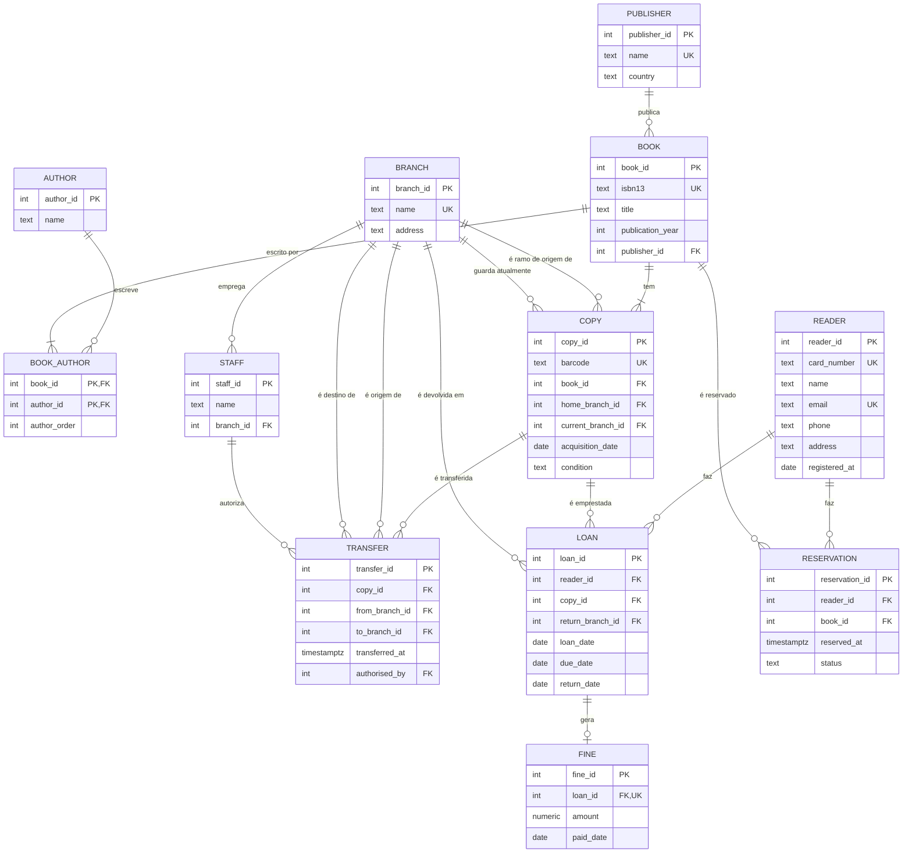

# Challenge 02 — Modelo com histórico de transferências entre ramos

**Objetivo.** Estender o modelo da biblioteca com histórico e verificá-lo contra
uma forma normal mais estrita (BCNF).

## 1. Modelo estendido

Parte-se do modelo do exercício da sessão 02. A biblioteca abre **três ramos**
(branches). Cada cópia:

- pertence a **um ramo de origem** (`home_branch_id`), que é o dono da cópia;
- pode ser **transferida** para outro ramo;
- pode ser **devolvida em qualquer ramo** (não só no ramo onde está guardada);
- tem de registar a sua **localização atual** e o **histórico completo** das
  transferências (de, para, data e quem autorizou).

Entidades novas: `BRANCH`, `STAFF`, `TRANSFER`. Entidades alteradas: `COPY`
(ganha `home_branch_id` e `current_branch_id`) e `LOAN` (ganha
`return_branch_id`).

### Diagrama ER



### Tabelas novas e alteradas

| Tabela | Colunas | PK | FK | UNIQUE |
|---|---|---|---|---|
| `branch` (nova) | `branch_id`, `name`, `address` | `branch_id` | — | `name` |
| `staff` (nova) | `staff_id`, `name`, `branch_id` | `staff_id` | `branch_id → branch` | — |
| `transfer` (nova) | `transfer_id`, `copy_id`, `from_branch_id`, `to_branch_id`, `transferred_at`, `authorised_by` | `transfer_id` | `copy_id → copy`, `from_branch_id → branch`, `to_branch_id → branch`, `authorised_by → staff` | — |
| `copy` (alterada) | + `home_branch_id`, + `current_branch_id` | `copy_id` | `home_branch_id → branch`, `current_branch_id → branch` | `barcode` |
| `loan` (alterada) | + `return_branch_id` | `loan_id` | `return_branch_id → branch` | — |

A **localização atual** fica em `copy.current_branch_id`, para que "onde está a
cópia X?" seja uma leitura de uma linha, sem varrer o histórico. O
**histórico** fica em `transfer`, uma linha por movimento.

### Como manter os dois coerentes

`copy.current_branch_id` é uma desnormalização deliberada (guarda-se o mesmo
facto que o histórico permite deduzir). A coerência é garantida por um
**trigger** em `transfer`: ao inserir uma transferência, atualiza
`copy.current_branch_id` para `to_branch_id` (e verifica que
`from_branch_id` é igual à localização atual antes da transferência). Assim o
caminho rápido e o histórico nunca divergem.

## 2. Duas perguntas em linguagem natural

**P1 — "Onde está a cópia X agora?"**

- Tabelas: `copy` (coluna `current_branch_id`) com junção a `branch` para o
  nome do ramo.
- Resposta em uma linha, sem ler o histórico:

  ```sql
  SELECT c.copy_id, b.name AS current_branch
  FROM copy c
  JOIN branch b ON b.branch_id = c.current_branch_id
  WHERE c.copy_id = :copy_id;
  ```

**P2 — "Que cópias saíram do ramo Y no mês passado?"**

- Tabelas: `transfer` (colunas `from_branch_id` e `transferred_at`), com
  junção a `copy` para identificar a cópia e a `branch` para o destino.

  ```sql
  SELECT t.copy_id, t.to_branch_id, t.transferred_at
  FROM transfer t
  WHERE t.from_branch_id = :branch_y
    AND t.transferred_at >= date_trunc('month', now() - interval '1 month')
    AND t.transferred_at <  date_trunc('month', now());
  ```

## 3. 3NF vs BCNF

**Definições.** Para uma dependência funcional não trivial `X → Y`:

- **3NF**: `X` é uma superchave **ou** `Y` é um atributo primo (faz parte de
  alguma chave candidata).
- **BCNF**: `X` é sempre uma superchave.

O BCNF é mais estrito: só falha o caso em que `X` não é superchave mas `Y` é
primo. Todas as tabelas em BCNF estão em 3NF, mas não o contrário.

**Dependências funcionais do modelo.** Em todas as tabelas, os únicos
determinantes não triviais são as chaves candidatas (o `PK` e as colunas
`UNIQUE`), que são superchaves por definição:

| Tabela | Chaves candidatas | Conclusão |
|---|---|---|
| `publisher` | `publisher_id`, `name` | BCNF |
| `author` | `author_id` | BCNF |
| `book` | `book_id`, `isbn13` | BCNF |
| `book_author` | `(book_id, author_id)`, `(book_id, author_order)` | BCNF |
| `copy` | `copy_id`, `barcode` | BCNF |
| `branch` | `branch_id`, `name` | BCNF |
| `staff` | `staff_id` | BCNF |
| `transfer` | `transfer_id` | BCNF |
| `reader` | `reader_id`, `card_number`, `email` | BCNF |
| `loan` | `loan_id` | BCNF |
| `reservation` | `reservation_id` | BCNF |
| `fine` | `fine_id`, `loan_id` | BCNF |

Em `book_author` as duas dependências `(book_id, author_id) → author_order` e
`(book_id, author_order) → author_id` têm como determinante uma chave
candidata, logo também está em BCNF. **Conclusão: nenhuma tabela do modelo
está em 3NF mas fora de BCNF — o modelo está inteiramente em BCNF (e portanto
em 3NF).**

**Exemplo da diferença (tabela hipotética, para ilustrar).** Considere uma
tabela de salas de estudo de um ramo:

```
booking(branch_id, room, capacity)
```

Regras: cada sala tem uma lotação fixa (`room → capacity`) e, dentro de um
ramo, não há duas salas com a mesma lotação (logo `(branch_id, capacity)` é
chave candidata). As chaves candidatas são `(branch_id, room)` e
`(branch_id, capacity)`. A dependência `room → capacity` tem `room` como
determinante que **não é superchave**, mas `capacity` é **primo** (faz parte de
`(branch_id, capacity)`). Então a tabela está em 3NF. Não está em BCNF, porque
`room` não é superchave. Para a pôr em BCNF separava-se em `room_capacity(room,
capacity)` e `branch_room(branch_id, room)`.
