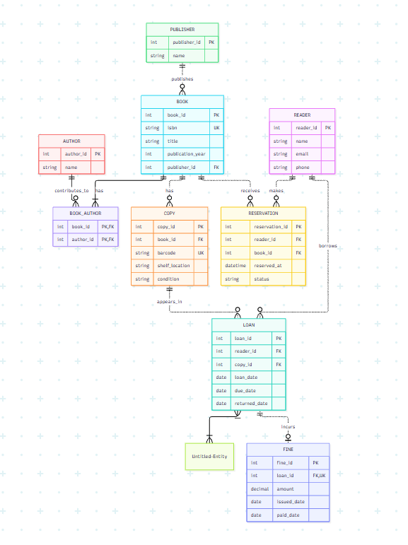

# Exercise 2
 
## 1., 2.

## 3.
 
# I wouldnt do any denormalisation because i think it would slow the entire process and database overrall, having multiple tables in this case i think is the best option