# Exercise

## 1. 
```bash 
SELECT title, length, rating 
FROM FILM
WHERE length > 120 
AND rating = 'PG-13'
ORDER BY title 
```
output
APOLLO TEEN, ARACHNOPHOBIA ROLLERCOASTER, ARGONAUTS TOWN até VOICE PEACH, WORLD LEATHERNECKS, WRONG BEHAVIOR
118 linhas


## 2.
```bash
SELECT first_name, last_name
from actor 
where last_name ilike '%son%';      
```
output
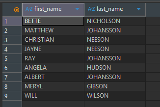


## 3.
```bash
select customer.first_name, customer.last_name, rental.last_update
from rental
inner join customer on rental.customer_id = customer.customer_id  
where rental.return_date is null;   
```
output
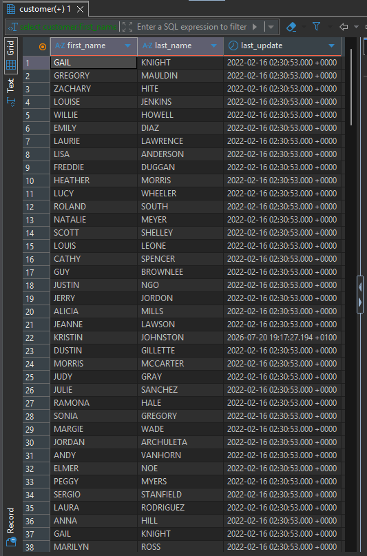
e termina com jacob, susan e jackie


## 4.
```bash
select max(rental_duration)
from film
group by rental_duration
order by rental_duration  
```
output
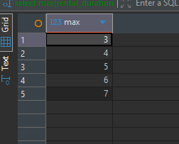

## 5.
```bash
select title,release_year,length
from film
order by title
offset 20 limit 10
```
output
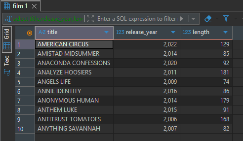

## 6. 
```bash
select count(rental_id) as rentals
from rental
where rental_date BETWEEN '2026-01-01' AND '2026-01-31'
--where rental_date >= '2026-01-01' AND rental_date < '2026-02-01'
-- o between nunca é usado para timestamp porque "arredonda" a hora para o dia e exclui alguns valores
``` 
output
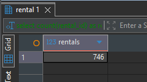
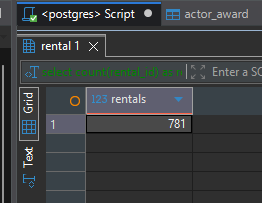
primeiro o script normal, depois o que está comentado

## 7.
```bash
INSERT INTO actor (first_name,Last_name)
VALUES ('ADA',  'LOVELACE')
RETURNING actor_id;
```
output


## 8.
```bash
BEGIN;

SELECT count(*)
FROM film
WHERE rating = 'NC-17'
  AND length < 60;

UPDATE film
SET rental_rate = rental_rate + 0.50
WHERE rating = 'NC-17'
  AND length < 60
RETURNING film_id, title, rental_rate;

commit;
```
output
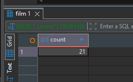


## 9.
```bash
INSERT INTO actor_award (actor_id, awards)
VALUES (1, 1)
ON CONFLICT (actor_id)
DO UPDATE SET awards = actor_award.awards + 1;
```
output
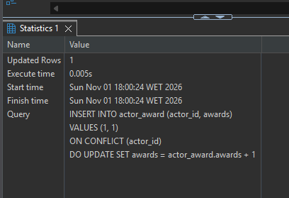

## 10.
```bash
INSERT INTO actor_award (actor_id, awards)
VALUES (2, 5)
ON CONFLICT (actor_id) DO NOTHING;
```
output
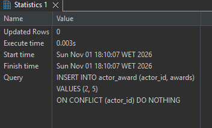

## 11.
```bash
INSERT INTO payment (customer_id, staff_id, rental_id, amount, payment_date)
VALUES
    (1, 2, 76, 0.01, '2026-07-30 12:00+00'),
    (1, 2, 76, 0.01, '2026-07-30 12:00+00'),
    (1, 2, 76, 0.01, '2026-07-30 12:00+00')
RETURNING payment_id;
```
output
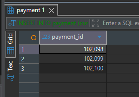

## 12.
```bash
BEGIN;

SELECT count(*)
FROM payment
WHERE customer_id = 1
  AND staff_id = 2
  AND rental_id = 76
  AND amount = 0.01
  AND payment_date = '2026-07-30 12:00+00';

DELETE FROM payment
WHERE customer_id = 1
  AND staff_id = 2
  AND rental_id = 76
  AND amount = 0.01
  AND payment_date = '2026-07-30 12:00+00'
RETURNING payment_id, customer_id, staff_id, rental_id, amount, payment_date;

COMMIT;
```
output
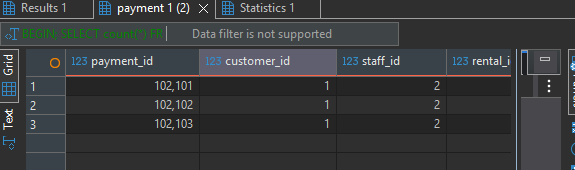
