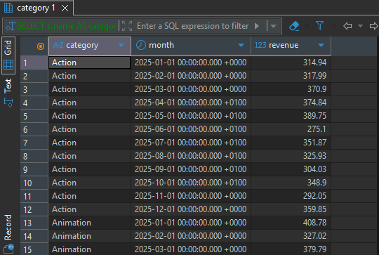
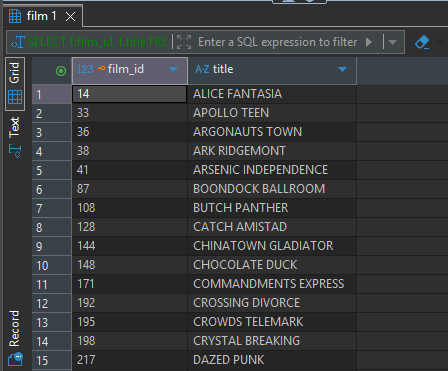
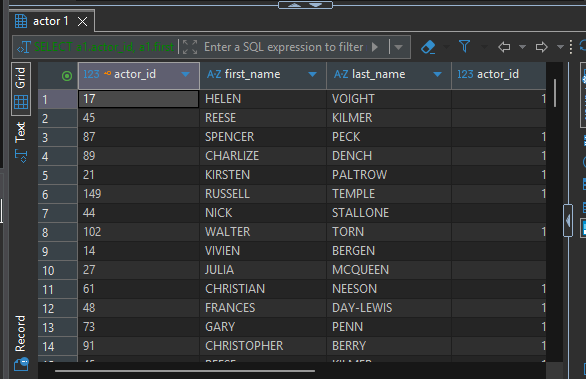
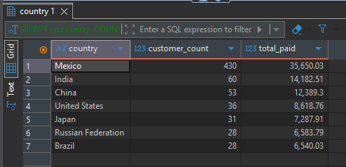
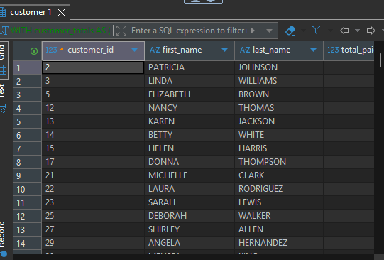
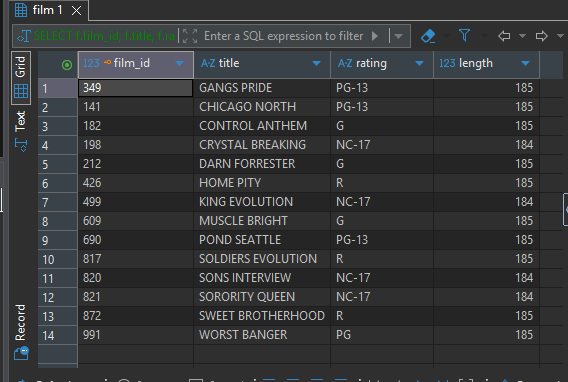
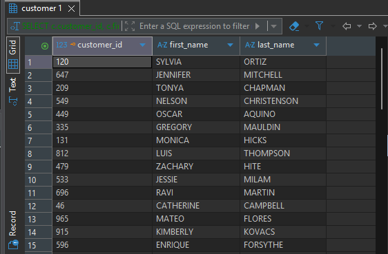
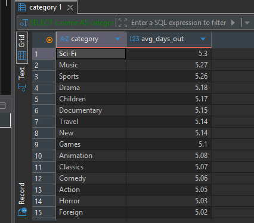

# Exercise

## 1. 
```bash 
SELECT c.name, COUNT(fc.film_id) AS film_count
FROM category c
LEFT JOIN film_category fc ON fc.category_id = c.category_id
GROUP BY c.category_id, c.name
ORDER BY film_count DESC, c.name;
```
output


## 2. 
```bash 
SELECT c.name AS category,
       date_trunc('month', p.payment_date) AS month,
       SUM(p.amount) AS revenue
FROM payment p
JOIN rental r       ON r.rental_id = p.rental_id
JOIN inventory i    ON i.inventory_id = r.inventory_id
JOIN film_category fc ON fc.film_id = i.film_id
JOIN category c     ON c.category_id = fc.category_id
WHERE p.payment_date >= '2025-01-01'
  AND p.payment_date <  '2026-01-01'
GROUP BY c.name, date_trunc('month', p.payment_date)
ORDER BY c.name, month;
```
output



## 3. 
```bash 
SELECT f.film_id, f.title
FROM film f
WHERE NOT EXISTS (
    SELECT 1
    FROM inventory i
    JOIN rental r ON r.inventory_id = i.inventory_id
    WHERE i.film_id = f.film_id
);
```
output


## 4. 
```bash 
SELECT c.customer_id, c.first_name, c.last_name
FROM customer c
JOIN rental r       ON r.customer_id = c.customer_id
JOIN inventory i    ON i.inventory_id = r.inventory_id
JOIN film f         ON f.film_id = i.film_id
GROUP BY c.customer_id, c.first_name, c.last_name
HAVING COUNT(DISTINCT f.rating) = (SELECT COUNT(DISTINCT rating) FROM film);
```
output



## 5. 
```bash 
SELECT a1.actor_id, a1.first_name, a1.last_name,
       a2.actor_id, a2.first_name, a2.last_name,
       COUNT(*) AS film_count
FROM film_actor fa1
JOIN film_actor fa2 ON fa2.film_id = fa1.film_id
                   AND fa2.actor_id > fa1.actor_id
JOIN actor a1 ON a1.actor_id = fa1.actor_id
JOIN actor a2 ON a2.actor_id = fa2.actor_id
GROUP BY a1.actor_id, a1.first_name, a1.last_name,
         a2.actor_id, a2.first_name, a2.last_name
HAVING COUNT(*) > 3;
```
output



## 6. 
```bash 
SELECT co.country,
       COUNT(*) AS customer_count,
       COALESCE(SUM(t.total_paid), 0) AS total_paid
FROM customer c
JOIN address a ON a.address_id = c.address_id
JOIN city ci   ON ci.city_id = a.city_id
JOIN country co ON co.country_id = ci.country_id
LEFT JOIN (
    SELECT customer_id, SUM(amount) AS total_paid
    FROM payment
    GROUP BY customer_id
) t ON t.customer_id = c.customer_id
GROUP BY co.country_id, co.country
HAVING COUNT(*) > 20
ORDER BY customer_count DESC;
```
output



## 7. 
```bash 
WITH customer_totals AS (
    SELECT c.customer_id, c.first_name, c.last_name,
           ci.country_id,
           COALESCE(SUM(p.amount), 0) AS total_paid
    FROM customer c
    JOIN address a ON a.address_id = c.address_id
    JOIN city ci   ON ci.city_id = a.city_id
    LEFT JOIN payment p ON p.customer_id = c.customer_id
    GROUP BY c.customer_id, c.first_name, c.last_name, ci.country_id
),
country_avg AS (
    SELECT country_id, AVG(total_paid) AS avg_paid
    FROM customer_totals
    GROUP BY country_id
)
SELECT ct.customer_id, ct.first_name, ct.last_name, ct.total_paid, ca.avg_paid
FROM customer_totals ct
JOIN country_avg ca ON ca.country_id = ct.country_id
WHERE ct.total_paid > ca.avg_paid;
```
output



## 8. 
```bash 
SELECT f.film_id, f.title, f.rating, f.length
FROM film f
WHERE f.length = (
    SELECT MAX(f2.length)
    FROM film f2
    WHERE f2.rating = f.rating
);
```
output



## 9. 
```bash 
SELECT c.customer_id, c.first_name, c.last_name
FROM customer c
WHERE NOT EXISTS (
    SELECT 1
    FROM rental r
    WHERE r.customer_id = c.customer_id
      AND r.rental_date >= '2026-04-01'
);
```
output



## 10. 
```bash 
SELECT c.name AS category,
ROUND(AVG(EXTRACT(EPOCH FROM (r.return_date - r.rental_date)) / 86400.0)::numeric, 2) AS avg_days_out
FROM rental r
JOIN inventory i      ON i.inventory_id = r.inventory_id
JOIN film_category fc ON fc.film_id = i.film_id
JOIN category c       ON c.category_id = fc.category_id
WHERE r.return_date IS NOT NULL
GROUP BY c.category_id, c.name
ORDER BY avg_days_out DESC;
```
output

