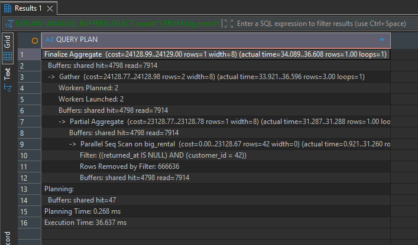
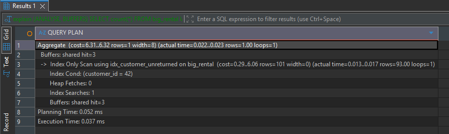
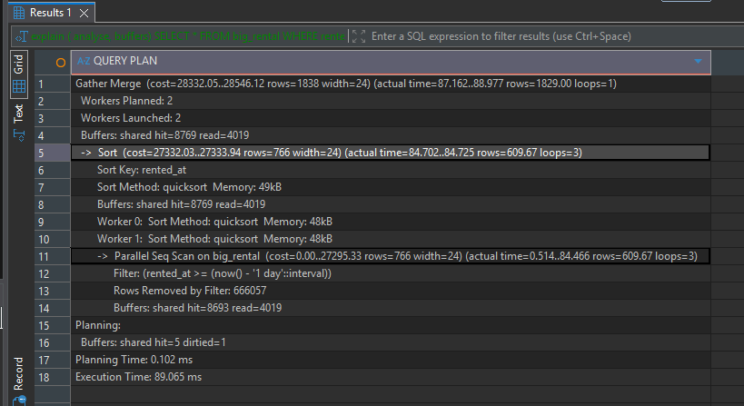

# Query 1 : Arrendamentos não devolvidos do utilizador 42

**Retorna:** Devolve o número de arrendamentos ainda não devolvidos do utilizador 42

## Antes



**Criar o Index:**
```sql
CREATE INDEX idx_customer_unreturned ON big_rental (customer_id) WHERE returned_at IS NULL;
```

## Depois



**Média:** 36,4 ms antes, 0.1 ms depois.

**Justificação:** Este index é muito melhor que a query normal porque verifica apenas 42 linhas que o 'returned_at IS NULL' então verifica apenas essas linhas invés de todas as linhas.

# Query 2: Arrendamentos do ultimo dia

**Retorna:** Todos os arrendamentos das ultimas 24H por ordem de mais antigo para mais recente.

## Antes



**Criar o Index:**
```sql
CREATE INDEX idx_rented_at ON big_rental (rented_at);
```

**Depois:**


**Média:** 85,1 ms antes, 2,4 ms depois.

**Justificação.** The query reads roughly 0.1% of the table, and the index finds those rows by range. The planner still sorts the 1,880 rows, which is cheap. A plain Index Scan could skip the sort, but the planner judged the bitmap approach cheaper at this size.

## Q3: rentals from ten days ago

**What it returns:** the rentals whose `rented_at` falls on the date `current_date - 10`, about 1,840 rows.

**Plan before:**
```
Gather
  -> Parallel Seq Scan on big_rental  (actual time=0.127..214.342 rows=614 loops=3)
       Filter: ((rented_at)::date = (CURRENT_DATE - 10))
       Rows Removed by Filter: 666053
Execution Time: 222.319 ms
```

**The obvious index does not help.** I first tried an index on the expression the query uses:

```sql
CREATE INDEX idx_q3_expr ON big_rental ((rented_at::date));
-- ERROR:  functions in index expression must be marked IMMUTABLE
```

The cast `timestamptz → date` depends on the session's `TimeZone`, so PostgreSQL marks it STABLE (`provolatile = 's'`), not IMMUTABLE. An index can only be built on an immutable expression, so this index is impossible. A plain index on `rented_at` does not help the query as written either: the planner still uses a Parallel Seq Scan, because the cast hides the column from the index.

**Plan after (original query, with `idx_rented_at` present):**
```
Gather
  -> Parallel Seq Scan on big_rental  (Filter: ((rented_at)::date = (CURRENT_DATE - 10)))
Execution Time: 235.252 ms
```
Median: 199.2 ms before, 235.3 ms after. No change, as expected. The difference is noise.

**Rewrite.** A day is the half-open interval `[day 00:00, next day 00:00)` in the session time zone, so the query can be written as a range on the bare column:

```sql
SELECT * FROM big_rental
WHERE rented_at >= (current_date - 10)::timestamptz
  AND rented_at <  (current_date - 9)::timestamptz;
```

**Plan after rewrite (with `idx_rented_at`):**
```
Bitmap Heap Scan on big_rental  (actual time=0.403..7.698 rows=1839 loops=1)
  Recheck Cond: ((rented_at >= ...) AND (rented_at < ...))
  -> Bitmap Index Scan on idx_rented_at  (actual time=0.227..0.228 rows=1839 loops=1)
Execution Time: 7.819 ms
```

**Median:** 3.1 ms for the rewritten query. The index is the same `idx_rented_at` as Q2, so no extra index is needed. The rewrite gives the same rows as the original, because both compare the date in the same session time zone.

## Q4: returned rentals per customer

**What it returns:** for each of the 600 customers, the number of rentals that have been returned. This covers 97% of the table.

**Plan before:**
```
Finalize GroupAggregate
  -> Gather Merge
       -> Sort (Sort Key: customer_id)
            -> Partial HashAggregate
                 -> Parallel Seq Scan on big_rental
Execution Time: ~384 ms (median of 3: 384.2 ms)
```

**Indexes tried, neither used by the planner:**
```sql
CREATE INDEX idx_q4a ON big_rental (returned_at);
CREATE INDEX idx_q4b ON big_rental (customer_id) WHERE returned_at IS NOT NULL;
```

With either index present the plan is unchanged: `Parallel Seq Scan on big_rental (cost=0.00..21069.33 ...)`. Medians: 323.3 ms and 385.4 ms in the isolated runs, and 358.7 ms in the final state. All of these fall inside the ±15% noise band of the baseline.

**Why the planner refuses.** The predicate matches 97% of rows and the query aggregates every one of them. Reading the whole table sequentially is cheaper than reading an index and then the same heap. An index scan can only win when it skips most of the table, and here it skips almost nothing.

**Forcing the index.** I checked whether the planner is right, by disabling sequential scans for the session (`SET enable_seqscan = off`) with `idx_q4b` present:

```
pair 1: seq scan 380.95 ms   Parallel Index Only Scan using idx_q4b 249.87 ms
pair 2: seq scan 375.10 ms   Parallel Index Only Scan using idx_q4b 235.20 ms
pair 3: seq scan 360.64 ms   Parallel Index Only Scan using idx_q4b 241.98 ms
```

The index-only plan is about 35% faster in this environment. The planner estimates it at cost 24,568 against 21,069 for the seq scan, so its cost model overestimates the index-only scan here. The index is smaller than the heap, which is why it reads fewer pages.

**Decision: no index.** This speed-up only appears when the planner is overridden for the whole session. Making it happen without that would mean changing planner cost settings for every query on the server. Those settings are not a per-query decision, so I did not make them. The index would also add write cost to every insert, so I keep no index for Q4. The result would be worth revisiting after changing the planner settings, but as written, Q4 is not helped by an index.

## Q5: recent rentals for three customers

**What it returns:** the rentals from the last 30 days for customers 7, 42 and 99, newest first (about 295 rows).

**Plan before:**
```
Gather Merge
  -> Sort (Sort Key: rented_at DESC)
       -> Parallel Seq Scan on big_rental  (actual time=0.372..117.098 rows=98 loops=3)
            Rows Removed by Filter: 666568
Execution Time: 125.393 ms
```

**Index tried first:** `idx_rented_at` alone. The planner uses it, but the index range covers 55,627 rows (the last 30 days of all customers), and the customer filter then discards about 55,000 of them after reading their heap pages. Isolated median: 30.0 ms. This is a real gain, but it reads far more rows than needed.

**Index kept:**
```sql
CREATE INDEX idx_customer_rented ON big_rental (customer_id, rented_at);
```

**Plan after:**
```
Sort  (Sort Key: rented_at DESC)
  -> Bitmap Heap Scan on big_rental  (actual time=0.127..1.368 rows=295 loops=1)
       Recheck Cond: ((customer_id = ANY ('{7,42,99}')) AND (rented_at >= (now() - '30 days')))
       -> Bitmap Index Scan on idx_customer_rented  (actual time=0.091..0.091 rows=295 loops=1)
Execution Time: 1.442 ms
```

**Median:** 125.4 ms before, 0.8 ms after with the composite index (final state, 0.8 ms; isolated, 0.8 ms).

**Why this index.** The equality column comes first, so each customer's rows form one contiguous range, and the time condition narrows within it. The index reads only about 295 rows. The sort stays because the `IN` list covers several customers, and PostgreSQL 16 has no skip scan to return rows already sorted across them. The sort costs little on 295 rows.

## Write cost

Protocol: for each run, `create-db.sh --reset` rebuilds the table from `setup.sql`. For the indexed case, `indexes.sql` is then applied before timing. Each mode was run 3 times, timing the insert of 100,000 rows.

```sql
INSERT INTO big_rental SELECT g, 1, now(), NULL FROM generate_series(2000001, 2100000) g;
```

| Table | Runs (ms) | Median |
|---|---|---|
| No indexes | 121, 94, 124 | 121 ms |
| Three indexes (`indexes.sql`) | 315, 324, 316 | 316 ms |

Each insert is about 2.6× slower with the three indexes. Every new row now has to be added to three B-trees as well as the heap:

- `idx_rented_at` gets a key that is always the largest, because `now()` is increasing. Those inserts append at the right edge of the tree, which is cheap.
- `idx_customer_rented` and `idx_customer_unreturned` get keys with `customer_id = 1`, which go into the same part of the tree each time. Every insert touches the same leaf pages.
- The partial index `idx_customer_unreturned` takes all 100,000 new rows, because the inserted `returned_at` is NULL.

Index maintenance and the extra WAL it writes account for the slowdown. The exact split between the three indexes is not measured here.

## Files

- `setup.sql`: table creation (exercise file).
- `scripts/create-db.sh`: database reset (minimal version).
- `scripts/bench.py`: three-run `EXPLAIN (ANALYZE, BUFFERS)` benchmark with median.
- `scripts/insert_bench.py`: insert timing with table rebuild before each run.
- `indexes.sql`: the three indexes kept (`idx_rented_at`, `idx_customer_unreturned`, `idx_customer_rented`).
- `queries/`: the five queries, the rewritten Q3, and the insert statement.
- `plans/`: the saved plan for each measured run.