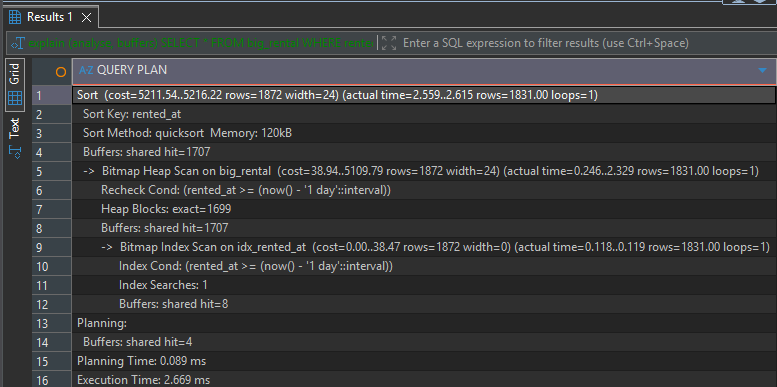
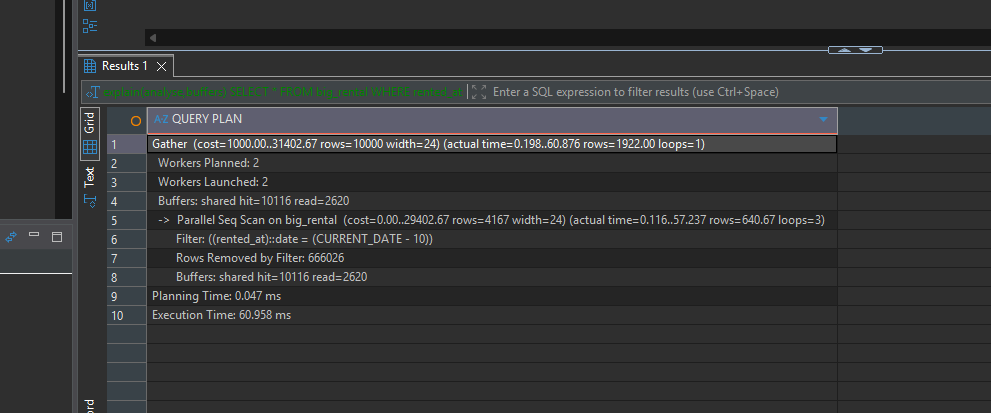
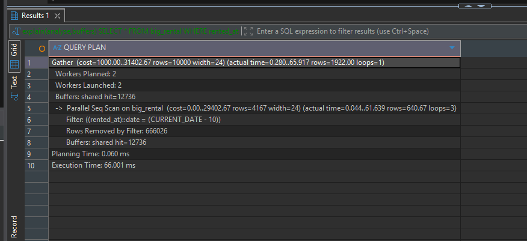
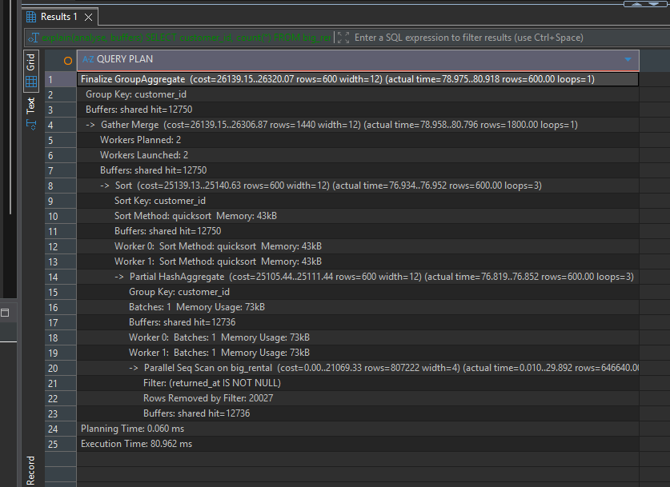
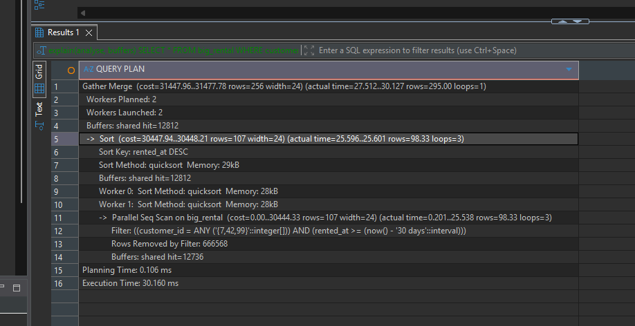
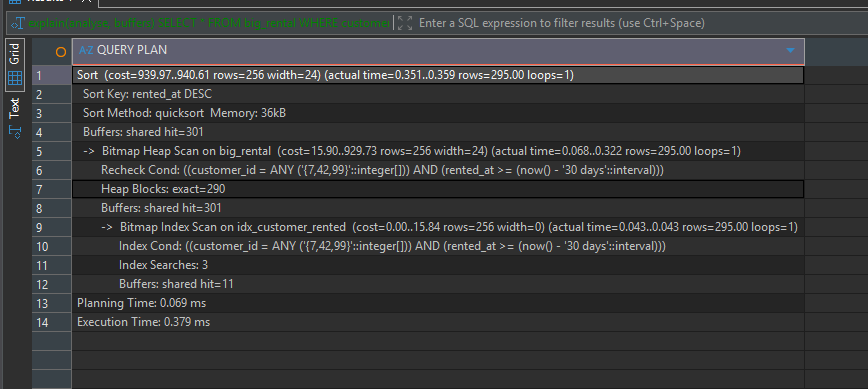

# Query 1 : Arrendamentos não devolvidos do utilizador 42

**Retorna:** Devolve o número de arrendamentos ainda não devolvidos do utilizador 42

## Antes


**Criar o Index:**
```sql
CREATE INDEX idx_customer_unreturned ON big_rental (customer_id) WHERE returned_at IS NULL;
```

## Depois


**Média:** 36,4 ms antes, 0.1 ms depois.

**Justificação:** Este index é muito melhor que a query normal porque verifica apenas 42 linhas que o 'returned_at IS NULL' então verifica apenas essas linhas invés de todas as linhas.

# Query 2: Arrendamentos do ultimo dia

**Retorna:** Todos os arrendamentos das ultimas 24H por ordem de mais antigo para mais recente.

## Antes


**Criar o Index:**
```sql
CREATE INDEX idx_rented_at ON big_rental (rented_at);
```

**Depois:**




**Média:** 85,1 ms antes, 2,4 ms depois.

**Justificação.** A query vê apenas os dados necessarios e reduz bastante o tempo de espera

# Query 3: Arrendamentos de 10 dias atrás

**Retorna:** Retorna todos os arrendamentos da data atual - 10 dias.

**Antes**



**Não é possivel fazer outro index**. A partir da query não há mais nada que seja possivel utilizar para fazer algum indice novo, por isso vou usar o do exercicio anterior.

**Depois (index do 2):**



Média de 67 ms, não tendo dados diferentes de depois porque o o postgresql não usou o index por ser ineficiente nesta situação

**Justificação.** Este index não funciona pois a query pega nos dados convertidos de um dos campos, ou seja não é possivel "indexar" o campo diretamente na query e por isso acaba por não ser usada      

# Query 4: Arrendamentos de cada utilizador

**Retorno:** Por cada utilizador mostra o número total de arrendamentos devolvidos

**Antes:**



**Index testados**
```sql
CREATE INDEX idx_q4a ON big_rental (returned_at);
CREATE INDEX idx_q4b ON big_rental (customer_id) WHERE returned_at IS NOT NULL;
```

**Nenhum foi usado** 

**Justificação:** Ambos os indexes que foram usados foram inuteis por um simples motivo, o select ainda precisa ver TODOS os campos de TODAS as linhas, então não há maneira de facilitar

# Query 5: Arrendamentos recentes dos utilizadores

**Retorno:** Vai buscar os arrendamentos dos ultimos 30 dias de 3 utilizadores espeficicos (7, 42 e 99)

**Antes:**



Primeiro testei o index do exercicio 2/3, mas reduzia muito pouco o tempo, tinha uma 
média de 28ms, e sem tinha uma média de 33ms.

**Index usado:**
```sql
CREATE INDEX idx_customer_rented ON big_rental (customer_id, rented_at);
```

**Depois:**



**Média:** 40ms antes, 0.3 ms depois.

**Justificação** Porque o index já "sabe" onde esses utilizadores estão, então pulam para os seus campos e apenas verificam pela data da query para fazer a verificação.